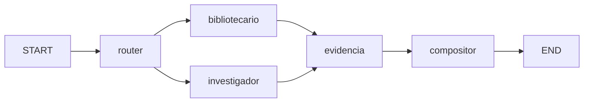

# AI Portfolio

Portfolio personal **conversacional**: en lugar de secciones estáticas, el visitante le hace preguntas en lenguaje natural (ES/EN) a un asistente de IA que responde y arma un **dashboard visual dinámico** con widgets (proyectos, experiencia, skills, timeline, educación, certificaciones, contacto, etc.).

**Live:** [diegolalanda.pages.dev](https://diegolalanda.pages.dev/)

- **Frontend** — Astro 5 + React Islands + Tailwind, sitio estático desplegado en **Cloudflare Pages**.
- **Backend** — FastAPI + LangGraph + Gemini, desplegado en **Railway** (rama `develop` = agentico).

---

## Tabla de contenidos

- [Arquitectura](#arquitectura)
- [Stack tecnológico](#stack-tecnológico)
- [Cómo funciona el asistente](#cómo-funciona-el-asistente)
- [Estructura del monorepo](#estructura-del-monorepo)
- [Puesta en marcha local](#puesta-en-marcha-local)
- [Variables de entorno](#variables-de-entorno)
- [Despliegue](#despliegue)
- [Documentación](#documentación)

---

## Arquitectura

```
   Visitante ──▶ Frontend (Astro + React, Cloudflare Pages)
                      │  POST /api/v1/chat/stream (SSE)
                      ▼
                 Backend (FastAPI, Railway)
                      │  LangGraph (GRAPH_ENGINE=langgraph)
                      ▼
        router ──▶ bibliotecario ──┐
              └──▶ investigador ──┴──▶ evidencia ──▶ compositor
                      │                    │
              app/data/*.json         app/rag/corpus/*.md
              (tools, hechos)         (RAG narrativo)
```

En **develop**, el camino por defecto es un **grafo LangGraph** con dos lectores en paralelo: el **bibliotecario** ejecuta las tools sobre JSON (milisegundos, sin embeddings) y el **investigador** busca solo en rutas `narrative`/`both` sobre markdown acotado (`backend/app/rag/corpus/`). **No** se indexan los JSON ni el HTML del sitio: los hechos van por tools; el RAG explica arquitectura cuando hace falta.

El loop legacy (`GRAPH_ENGINE=legacy`) sigue en el código para comparar, pero el grafo es el motor principal en develop.

Para hilos de conversación, trazas OpenTelemetry y despliegue de Phoenix en Railway, mirá [`docs/ARCHITECTURE.md`](docs/ARCHITECTURE.md).

### Grafo (LangGraph)



---

## Stack tecnológico

### Frontend
- [Astro 5](https://astro.build/) (output estático / SSG) con i18n `es` (default) + `en`
- [React 18](https://react.dev/) como *islands* para la interactividad puntual
- [Tailwind CSS](https://tailwindcss.com/) + [shadcn/ui](https://ui.shadcn.com/)
- [Motion](https://motion.dev/) para animaciones y [three.js](https://threejs.org/) para el fondo ambiental
- TypeScript en modo estricto (alias `@/*` → `src/*`)

### Backend
- [FastAPI](https://fastapi.tiangolo.com/) + [Uvicorn](https://www.uvicorn.org/)
- [LangGraph](https://langchain-ai.github.io/langgraph/) + LangChain (router / compositor)
- [Pydantic v2](https://docs.pydantic.dev/) / `pydantic-settings` para config y contratos
- [google-genai](https://pypi.org/project/google-genai/) — chat `gemini-3.1-flash-lite`, embeddings Gemini para RAG
- RAG híbrido: Chroma en memoria + BM25 sobre `app/rag/corpus/`
- OpenTelemetry + OpenInference (trazas JSONL o OTLP hacia Phoenix)
- Python 3.12+

### Infraestructura
- **Cloudflare Pages** — hosting del frontend estático + CDN global
- **Railway** — hosting del backend FastAPI

---

## Cómo funciona el asistente

1. El visitante escribe una pregunta (ej. *"¿Qué proyectos de IA hiciste?"*).
2. El frontend abre un stream **SSE** contra `POST /api/v1/chat/stream` y envía contexto de sesión (`thread_id`, widgets ya mostrados, preguntas previas).
3. El **router** (Gemini) elige ruta, tools e idioma sin ver el JSON crudo de las tools.
4. El **bibliotecario** corre las tools contra `app/data/*.json`. El **investigador** recupera pasajes markdown solo si la ruta lo pide.
5. El **compositor** (Gemini) devuelve `AgentResponse` estructurado (`title`, `summary`, `widgets[]`, `suggested_actions[]`).
6. El frontend mapea cada `widget.type` a un componente React (`widgetRegistry.ts`).

**Tools disponibles** (una por dominio, todas leen un único JSON): `get_projects`, `get_experience`, `get_skills`, `get_soft_skills`, `get_timeline`, `get_education`, `get_certifications`, `get_languages`, `get_contact`.

---

## Estructura del monorepo

```
ai-portfolio/
├── frontend/          # Aplicación Astro + React Islands (Cloudflare Pages)
│   ├── src/
│   │   ├── components/   # ui/ (shadcn), layout/, sections/, react/ (islands)
│   │   ├── i18n/         # Diccionarios es/en
│   │   ├── lib/          # Cliente de API, helpers, efectos visuales
│   │   ├── pages/        # Routing file-based (es + /en)
│   │   └── types/        # Contratos compartidos con el backend
│   └── public/           # Estáticos (imágenes, CV en PDF)
├── backend/           # API FastAPI + LangGraph (Railway)
│   ├── app/
│   │   ├── graph/         # Grafo LangGraph (5 nodos)
│   │   ├── rag/           # RAG híbrido sobre corpus markdown
│   │   ├── observability/ # Trazas OTEL
│   │   ├── eval/          # Rúbrica offline
│   │   ├── ai/            # Legacy + cliente Gemini
│   │   ├── api/v1/        # /chat, /chat/stream
│   │   ├── data/          # JSON del portfolio
│   │   ├── tools/         # get_* sobre data/
│   │   └── …              # schemas, services, prompts, llm, core
│   ├── evaluar.py
│   └── tests/
├── docs/              # Documentación (arquitectura, despliegue)
└── README.md
```

---

## Puesta en marcha local

### Requisitos
- Node.js 20+
- Python 3.12+
- Una API key de Google Gemini ([Google AI Studio](https://aistudio.google.com/apikey))

### Backend

```bash
cd backend
python -m venv .venv
.venv\Scripts\activate        # Windows (macOS/Linux: source .venv/bin/activate)
pip install -r requirements.txt
copy .env.example .env         # y completar GEMINI_API_KEY
python run.py
```

API en `http://127.0.0.1:8000` · Swagger UI en `http://127.0.0.1:8000/docs`.

### Rúbrica y tests (sin API key)

Desde `backend`:

```bash
python evaluar.py          # pytest offline: golden set + grafo con modelo falso
python -m pytest -q        # equivalente
python evaluar.py --live   # opt-in: latencia/tokens contra Gemini → evidencia/medicion.json
```

CI y `pytest` pelado usan `-m "not live"` (ver `pytest.ini`). Los endpoints HTTP en tests siguen mockeando `get_answer` donde corresponde; la rúbrica ejercita el grafo en proceso vía `app/eval/golden_model.py`.

**Trazas locales:** con `PHOENIX_COLLECTOR_ENDPOINT` vacío, cada chat appendea spans en `backend/evidencia/trazas.jsonl`. **Producción:** servicio [Phoenix en Railway](https://railway.com/deploy/arize-phoenix-or-just-updated-llm-tracing-evals-data-survives-redeploys--arize-phoenix-or-just-updated-llm-tracin) aparte + `PHOENIX_COLLECTOR_ENDPOINT` en el API (ver `backend/.env.example`).

### Frontend

```bash
cd frontend
npm install
copy .env.example .env         # PUBLIC_API_URL apunta al backend
npm run dev
```

Sitio en `http://localhost:4321`.

---

## Variables de entorno

### Backend (`backend/.env`)

Copiá [`backend/.env.example`](backend/.env.example) y completá al menos `GEMINI_API_KEY`.

| Variable | Descripción | Default |
|---|---|---|
| `GEMINI_API_KEY` | Chat + embeddings RAG | *(vacío)* |
| `GRAPH_ENGINE` | `langgraph` o `legacy` | `langgraph` |
| `EMBEDDING_PROVIDER` | `gemini` / `hash` (tests) | `gemini` |
| `CHECKPOINT_PATH` | Hilos LangGraph (SQLite) | `data/checkpoints.sqlite` |
| `PHOENIX_COLLECTOR_ENDPOINT` | OTLP Phoenix; vacío → JSONL local | *(vacío)* |
| `ENVIRONMENT` | `development` / `production` | `development` |
| `HOST` / `PORT` / `RELOAD` | Uvicorn | `127.0.0.1` / `8000` / `true` |
| `BACKEND_CORS_ORIGINS` | CORS (lista JSON) | `["http://localhost:4321"]` |

Timeouts LLM, RAG, trazas y Phoenix: ver comentarios en `.env.example`.

### Frontend (`frontend/.env`)

| Variable | Descripción | Default |
|---|---|---|
| `PUBLIC_API_URL` | URL base del backend FastAPI | `http://localhost:8000` |

> Las variables `PUBLIC_*` de Astro se inyectan en el bundle del cliente: no poner secretos ahí. La `GEMINI_API_KEY` vive **solo** en el backend.

---

## Despliegue

- **Frontend → Cloudflare Pages.** Build `npm run build`, directorio de salida `dist/`. Configurar `PUBLIC_API_URL` con la URL pública del backend.
- **Backend → Railway.** Start `python run.py`. Variables mínimas: `GEMINI_API_KEY`, `BACKEND_CORS_ORIGINS`, `GRAPH_ENGINE=langgraph` si desplegás `develop`. Phoenix opcional (segundo servicio). Ver [`docs/DEPLOYMENT.md`](docs/DEPLOYMENT.md).
- **Health check → GitHub Actions.** El workflow `.github/workflows/backend-health.yml` consulta `GET /health` cada 10 minutos. Configurar el secreto `BACKEND_HEALTH_URL` con la URL pública del backend, sin `/health` al final.

Guía paso a paso en [`docs/DEPLOYMENT.md`](docs/DEPLOYMENT.md).

---

## Cómo leer este repo (reclutador / OSS)

1. [`docs/ARCHITECTURE.md`](docs/ARCHITECTURE.md) — flujo end-to-end.
2. `backend/app/graph/` — grafo LangGraph (router → lectores → compositor).
3. `backend/evaluar.py` — rúbrica offline sin API key.
4. Demo en [diegolalanda.pages.dev](https://diegolalanda.pages.dev/) (backend agentico en rama **`develop`**).

---

## Documentación

- [`docs/ARCHITECTURE.md`](docs/ARCHITECTURE.md) — LangGraph, RAG, hilo, trazas, SSE, widgets.
- [`docs/DEPLOYMENT.md`](docs/DEPLOYMENT.md) — Cloudflare Pages, Railway, Phoenix.
- [`SECURITY.md`](SECURITY.md) — secretos, API pública, reporte de vulnerabilidades.
- [`backend/app/data/README.md`](backend/app/data/README.md) — forma de los JSON de contenido.
- [`backend/app/schemas/README.md`](backend/app/schemas/README.md) — contrato de widgets.

---

Desarrollado por [Diego Javier Lalanda](https://www.linkedin.com/in/diego-lalanda-9576b21b8/) · [GitHub](https://github.com/DiegoLalanda)
