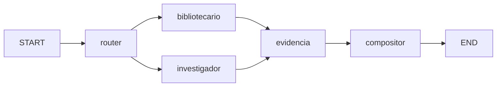

# Arquitectura

Este documento explica cómo funciona el portfolio conversacional por dentro: el flujo de una pregunta desde el navegador hasta el dashboard renderizado.

En la rama **`develop`**, el motor por defecto es **LangGraph** (`GRAPH_ENGINE=langgraph`). La rama **`main`** puede seguir desplegada con el loop legacy hasta que merges y redeploys el backend agentico.

## Visión general

```
Frontend (Astro + React)                 Backend (FastAPI + LangGraph)
────────────────────────                 ─────────────────────────────
AgentResponseIsland                      POST /api/v1/chat/stream
  streamChatMessage() + thread_id            │
  (SSE)                                      ▼
  └──────────────────────────────▶  stream_chat_events()
                                              │
                         GRAPH_ENGINE=langgraph ▼
                                    LangGraph (5 nodos)
                                              │
                         ┌────────────────────┼────────────────────┐
                         ▼                    ▼                    │
                   app/data/*.json    app/rag/corpus/*.md           │
                   (tools, hechos)    (solo narrative/both)         │
                         └────────────────────┴────────────────────┘
                                              ▼
                                    AgentResponse (JSON)
  ◀──────────── evento SSE "done" ──────────┘
  WidgetRenderer → widgetRegistry
```

## Principios de diseño

- **Sin base de datos de contenido.** El portfolio vive en JSON versionados en `backend/app/data/`. Editar el portfolio = editar un JSON.
- **Hechos por tools, narrativa por RAG acotado.** Las tools leen JSON en milisegundos; **no** se indexan los JSON ni el HTML del sitio. Preguntas de arquitectura o “por qué” pueden recuperar pasajes de `backend/app/rag/corpus/*.md` (BM25 + Chroma en memoria) solo cuando el router elige `narrative` o `both`.
- **Un modelo de chat.** `gemini-3.1-flash-lite` para router y compositor. Embeddings Gemini (misma API key) solo en el camino RAG.
- **Contrato estructurado.** El agente devuelve `AgentResponse` (`title`, `summary`, `widgets[]`, `suggested_actions[]`). El frontend mapea `widget.type` a componentes React.
- **Contrato SSE estable.** Eventos `started`, `status`, `tool_call`, `tool_done`, opcional `retrieval`, `done`, `error`. El front ignora tipos desconocidos.

## Grafo LangGraph

Código: `backend/app/graph/` (`builder.py`, `nodes.py`, `state.py`).



| Nodo | LLM | Rol |
|---|---|---|
| **router** | Sí | Ruta (`facts` / `narrative` / `both` / `direct`), tools, idioma, `retrieval_query`. Prompt corto (tools + idioma), sin JSON de tools. |
| **bibliotecario** | No | Ejecuta tools contra `app/data/*.json`. Emite `tool_call` / `tool_done`. |
| **investigador** | No | Busca en el corpus markdown solo si la ruta es `narrative` o `both` y `rag_ready`. Emite `retrieval`. |
| **evidencia** | No | Empaqueta facts + `project_ids` + pasajes (`defer=True`, join de los dos lectores). |
| **compositor** | Sí | Un `AgentResponse` con grounding; un reintento si falla Pydantic o un id de proyecto fuera del pack. |

Orquestación SSE: `app/services/chat_stream.py` traduce `astream_events` v2 a los mismos eventos que el front ya entiende.

## Flujo detallado (LangGraph)

1. **Entrada.** `stream_chat_events()` recibe `question`, `shown_widget_types`, `prior_questions` y opcional `thread_id`. `prepare_graph_turn()` arma el prompt (`app/services/chat_context.py` + `app/services/graph_session.py`).
2. **Router.** Una llamada estructurada → `RouterDecision`.
3. **Lectores en paralelo.** Bibliotecario (tools) e investigador (RAG condicional).
4. **Evidencia.** Paquete determinista para el compositor.
5. **Compositor.** Una llamada estructurada → `AgentResponse`. Timeout router 12 s, compositor 25 s (`app/llm/provider.py`).
6. **Streaming.** Eventos SSE durante el grafo; `done` solo al terminar el nodo `compositor`.

Modelo único: `gemini-3.1-flash-lite`. Cliente LangChain con fallback a `google-genai` si el wrapper rechaza el id.

## Eventos SSE

| Evento | Significado |
|---|---|
| `started` | Se abrió el stream |
| `status` (`phase: thinking` \| `synthesizing`) | Razonamiento o síntesis |
| `tool_call` / `tool_done` | Tool del bibliotecario |
| `retrieval` (`count`) | Pasajes recuperados (RAG) |
| `done` (`response: AgentResponse`) | Respuesta final |
| `error` (`message`) | Fallo (timeout, API, validación) |

## Endpoints

Definidos en `backend/app/api/v1/endpoints/chat.py`, prefijo `/api/v1`.

| Método | Ruta | Descripción |
|---|---|---|
| `POST` | `/api/v1/chat` | Respuesta completa (`ChatResponse` = `AgentResponse`) |
| `POST` | `/api/v1/chat/stream` | **SSE** (preferido por el frontend) |
| `GET` | `/health` | `{"status": "ok"}` — no depende de Gemini, RAG ni Phoenix |
| `GET` | `/docs` | Swagger UI |

Rate limiting: 10 req/min por IP (`app/core/rate_limiter.py`), en memoria.

### Request de chat

```jsonc
{
  "question": "¿Qué proyectos de IA hiciste?",
  "shown_widget_types": ["projects"],
  "prior_questions": ["¿Quién es Diego?"],
  "thread_id": "550e8400-e29b-41d4-a716-446655440000"
}
```

- **`thread_id`:** opcional, formato **UUID** (el front genera uno con `crypto.randomUUID()` en `frontend/src/lib/chat-thread.ts`). Con hilo, el servidor recuerda preguntas previas en el checkpointer; sin hilo, vale `prior_questions` en el body.
- **`shown_widget_types`:** siempre del cliente (widgets ya visibles en el dashboard).

## Hilo de conversación (LangGraph)

`AsyncSqliteSaver` en `CHECKPOINT_PATH` (default `data/checkpoints.sqlite`), inicializado en el lifespan de FastAPI. Si SQLite no abre → `MemorySaver` y el chat responde igual.

### Por qué SQLite y no Redis

La migración **no incluye Redis**. Para una réplica del API alcanza SQLite en disco; un **redeploy en Railway borra** el archivo del contenedor del API (el hilo del visitante se pierde hasta que uses volumen compartido o Redis).

| Criterio | SQLite | Redis |
|---|---|---|
| Infra | Archivo local + `langgraph-checkpoint-sqlite` | Servicio aparte |
| Caso actual | Una réplica, follow-ups en la visita | Varias réplicas del API |

## Trazas (OpenTelemetry)

Spans por nodo con `prompt.version` y `langgraph.node`. OpenInference instrumenta LangChain.

- **Local:** `PHOENIX_COLLECTOR_ENDPOINT` vacío → `backend/evidencia/trazas.jsonl` (gitignored).
- **Producción:** [Phoenix en Railway](https://railway.com/deploy/arize-phoenix-or-just-updated-llm-tracing-evals-data-survives-redeploys--arize-phoenix-or-just-updated-llm-tracin) como **segundo servicio** (volumen en Phoenix; trazas de la UI sobreviven redeploys del servicio Phoenix). En el API: `PHOENIX_COLLECTOR_ENDPOINT=https://<phoenix>.up.railway.app/v1/traces`, `PHOENIX_PROJECT_NAME=ai-portfolio`, `TRACE_JSONL=false`. Ver [`DEPLOYMENT.md`](DEPLOYMENT.md).

## Motor legacy (`GRAPH_ENGINE=legacy`)

Respaldo del loop original en `backend/app/ai/gemini_agent.py`: *function calling* manual (hasta 12 turnos), tools vía SDK Gemini, mismo contrato `AgentResponse`. Se usa en tests de paridad y si el flag apunta a `legacy`. Producción en `main` puede seguir en legacy hasta actualizar variables y rama desplegada.

## Contrato `AgentResponse`

Definido en `backend/app/schemas/agent_response.py` y espejado en `frontend/src/types/agent-response.ts`.

```jsonc
{
  "language": "es",
  "title": "Proyectos de IA de Diego",
  "summary": "Diego trabajó en...",
  "widgets": [
    {
      "id": "projects-ai",
      "type": "projects",
      "title": "Proyectos destacados",
      "data": { "items": [ /* ... */ ] }
    }
  ],
  "suggested_actions": [
    { "label": "Ver experiencia", "action": "ask", "payload": "¿Dónde trabajó Diego?" }
  ]
}
```

**Tipos de widget** (`WidgetType`): `text`, `timeline`, `skills`, `projects`, `technology-cloud`, `education`, `contact`, `experience`, `certifications`, `languages`, `soft-skills`.

**Acciones sugeridas** (`ActionType`): `ask`, `link`, `contact`.

## Tools y datos

Cada tool en `backend/app/tools/get_*.py` lee un JSON de `backend/app/data/`:

| Tool | Archivo |
|---|---|
| `get_projects` | `projects.json` |
| `get_experience` | `experience.json` |
| `get_skills` | `skills.json` |
| `get_soft_skills` | `softskills.json` |
| `get_timeline` | `timeline.json` |
| `get_education` | `education.json` |
| `get_certifications` | `certifications.json` |
| `get_languages` | `languages.json` |
| `get_contact` | `contact.json` |

Forma de los JSON: [`backend/app/data/README.md`](../backend/app/data/README.md).

## Evaluación (rúbrica)

- **Offline:** `python evaluar.py` o `pytest` (sin `-m live`) — grafo + golden set con `app/eval/golden_model.py`, sin API key.
- **Live:** `python evaluar.py --live` — latencia y tokens contra Gemini → `backend/evidencia/medicion.json` (gitignored).

Golden set: `backend/tests/golden/preguntas.jsonl`.

## Frontend: del evento al widget

- `frontend/src/lib/api.ts` — SSE, `thread_id`, contexto de sesión.
- `frontend/src/components/react/AgentResponseIsland.tsx` — follow-ups y loading.
- `frontend/src/components/react/agent-response/widgetRegistry.ts` — mapa `widget.type` → componente.

## i18n

- Astro: `defaultLocale: "es"`, inglés bajo `/en`.
- UI: `frontend/src/i18n/{es,en}.ts`.
- Respuesta del agente: idioma de la pregunta (`AgentResponse.language`).
